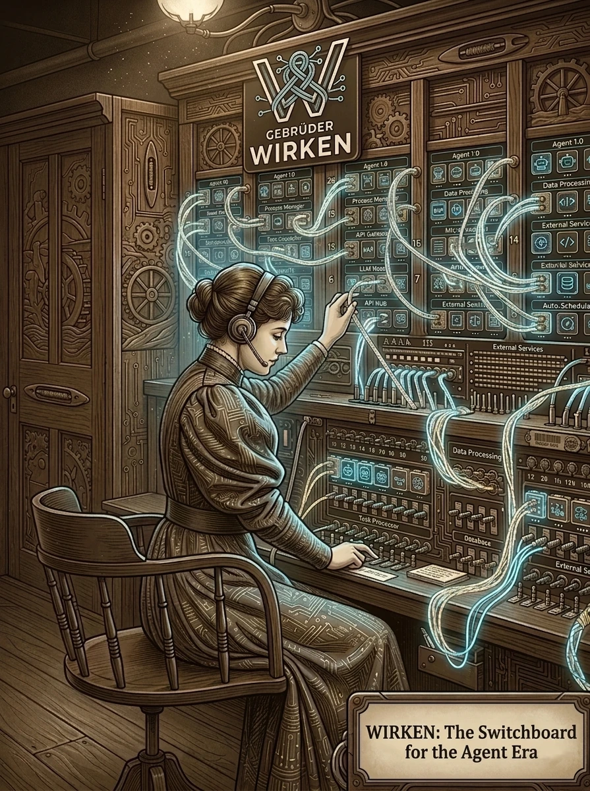
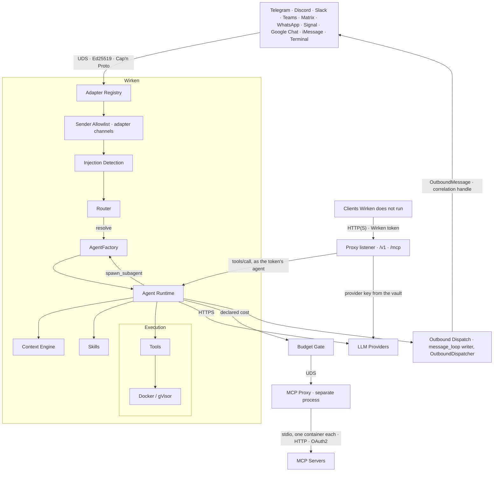
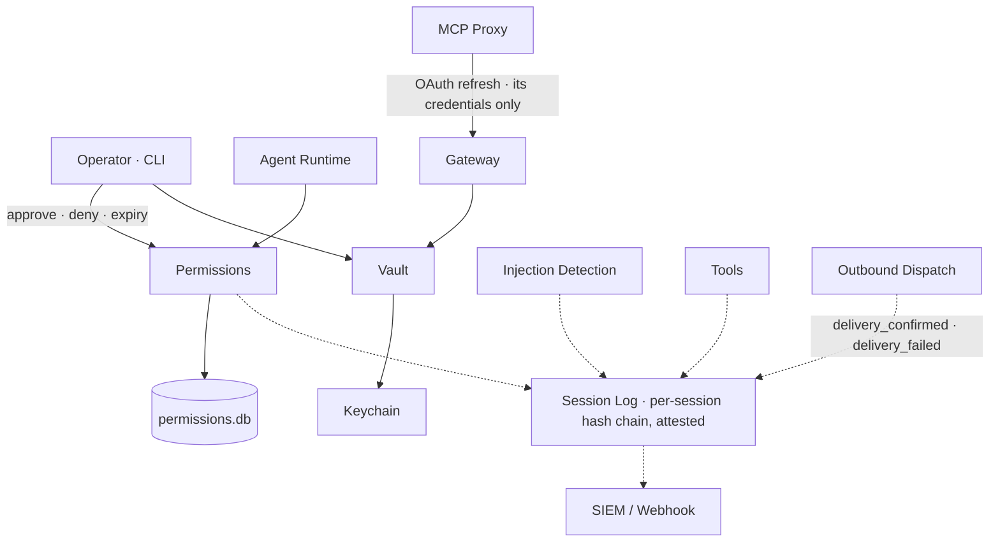

# Wirken

[](LICENSE) [](https://github.com/gebruder/wirken/actions/workflows/ci.yml) [](https://github.com/gebruder/wirken/releases)



Wirken is the enterprise gateway for autonomous agents: the switchboard
between your team's messaging channels and the AI agents working on their
behalf. Your people reach it from a browser or the chat platforms they already
use, and the agent on the other end reads files, calls APIs, and runs tools
for them. Each channel gets its own line.

It also stands in front of agents it does not run. A coding agent or a script
points its model base URL and its MCP client at Wirken and holds a Wirken
token in place of provider keys and server credentials. Its model calls are
recorded, and its tool calls pass the same gate an agent's do.

Wirken is built for the security team that has to answer for what those agents
do. It assumes any agent can be turned against you, and boxes in what a
compromised one can reach.

It ships as a single static Rust binary, so it runs wherever your controls
require: a locked-down workstation, a server inside your network, or an
air-gapped host. Its model connection is provider-agnostic: frontier APIs,
local weights through Ollama, TEEs for encrypted processing, Swiss- and
EU-hosted endpoints, or a ChatGPT plan the operator has, all
interchangeable. Each agent runs the model you assign it. A per-agent budget
can alert on or refuse calls past a ceiling, in USD or, for a local model
with no price, in seconds of model time; it is off until configured. MIT
licensed.

## How it works

A message comes in on a channel, Wirken wakes an agent to handle it, and every
file it reads, API it calls, and tool it runs passes through Wirken's controls
first.

- **The agent is untrusted.** The guarantees below do not depend on the model
  behaving, whether it is carrying a prompt-injection payload or drifting over
  a long session.
- **Credentials never reach the model.** Tokens and keys stay in an
  [encrypted vault](docs/credentials.md). Wirken supplies them at the edge; the
  agent and the LLM never see them.
- **Every action is logged and attributed.** Each tool call is written to a
  [hash-chained audit log with signed chain heads](docs/audit-cli.md) as a
  typed event, tagged with the sender who triggered it, before it executes.
  Its outcome is written after it.
- **Least privilege by default.** A [three-tier permission
  model](docs/permissions-and-identity.md), and any sub-agent an agent spawns
  is boxed by limits you set.
- **Shell commands run in a sandbox.** By default, anything the agent executes
  runs in an [ephemeral container](docs/sandbox-properties.md) with no network.
  `wirken agents set-egress` gives a channel's commands a
  [proxied route](docs/egress.md#sandbox-egress): under `allowlist` each
  request to a listed host is asked of the operator, and under `open` an
  agent turn's command is refused every request. `sandbox.json` can turn
  networking on or the container off. If the sandbox is unavailable,
  execution is refused rather than run on the host.
- **Clients Wirken does not run get the same record and the same gate.** In
  [proxy mode](docs/proxy.md) another agent's model calls go through Wirken
  with the vault's provider key, each one a row with the hash of what was
  exchanged, and its MCP tool calls run as one of Wirken's agents: Tier 3,
  asked of the operator every time.

## Install

Prerequisites: Linux (x86_64 or aarch64), macOS (Intel or Apple Silicon), or
Windows 11 (x86_64); at least one model endpoint; and Docker if you want shell
commands sandboxed, which is the default. Without Docker the agent cannot run
shell commands, and stdio MCP servers do not start: each one runs in its own
container unless its `mcp.json` entry sets `"sandbox": "off"` to run it on the
host ([docs/mcp.md](docs/mcp.md)).

```bash
curl -fsSL https://raw.githubusercontent.com/gebruder/wirken/main/install.sh | sh

wirken setup
wirken run
```

Pin the installer before piping. The committed `install.sh` has this SHA-256:

```
085faf0359384403e4e80d1e75734b84cec7ce92182d9012c7879f9bc681fb70
```

```bash
curl -fsSL https://raw.githubusercontent.com/gebruder/wirken/main/install.sh | sha256sum
```

What the installer verifies, and how to check a release by hand:
[docs/signing.md](docs/signing.md#release-signing).

Prebuilt binaries cover Linux (x86_64, aarch64), macOS (x86_64, Apple
Silicon), and Windows 11 (x86_64). The Linux binaries are statically linked
against musl with no glibc dependency. The bash installer does not apply on
Windows; see [docs/windows.md](docs/windows.md) for that path and the
feature-set differences.

`wirken run` spawns adapter processes, accepts authenticated connections,
routes messages to the agent, and serves a WebChat UI at
`http://127.0.0.1:18790`; log in with `wirken webchat open --browser`:

```
  wirken v3.5.2
  ──────

  Provider: ollama/llama3.2
  Ollama version: 0.19.0
  Route: Telegram -> agent:default
  WebChat: http://127.0.0.1:18790 (log in with `wirken webchat open`)

  Wirken running. Press Ctrl+C to stop.
```

WebChat, the adapter webhook listeners and every socket bind to 127.0.0.1.
The proxy listener is off unless the data directory has a `proxy.json`. It
binds 127.0.0.1:18791 by default, and beyond loopback only when `proxy.json`
sets `tls` or `bind_beyond_loopback`
([docs/inference-proxy.md](docs/inference-proxy.md#tls)).

**Running modes.** Interactive (`wirken run` in the foreground), browser (the
same command serves WebChat), in the terminal (`wirken chat`, a channel of
the running gateway), as a service (`wirken setup --install-service`
installs a systemd user unit or launchd agent), or scheduled (`wirken preset
schedule <name>` runs preset agents on a cron schedule with no human in the
loop, under the same permission and audit controls). Service and scheduled
modes are Linux and macOS only.

## Try the demo

1. Install wirken with `install.sh`, as above.
2. Start Docker.
3. `git clone https://github.com/gebruder/wirken && cd wirken`
4. Run `scripts/demo/stage.sh up`, then `scripts/demo/stage.sh ask`; [scripts/demo/README.md](scripts/demo/README.md) is the runbook.

Three hands-on exercises, from writing a permission policy to red teaming the gate: [docs/workshop/](docs/workshop/README.md).

Lyrik on code you don't trust: [docs/lyrik.md](docs/lyrik.md#running-on-code-you-dont-trust)
lists each protection a Lyrik run has against a hostile target and the test
that proves it. From the clone, on Linux with `git` and util-linux `script`:

```bash
cargo test -p wirken-cli --test lyrik_team_files_stay_locked --test lyrik_run_reaches_no_network \
  --test lyrik_provenance_runs_nothing_the_repo_configures --test lyrik_exec_sandbox_only \
  --test lyrik_signoff --test lyrik_inference_matches_the_chain
```

## Uninstall

Removing the data directory destroys the audit log with it. With a proxy
archive it also destroys `proxy_archive_keys.db` and the archive key in the
vault: the bodies in the bucket stay locked until their retention ends and
can no longer be read. Export first if any retention need applies, and keep
`vault.db`, `keychain/` and `proxy_archive_keys.db` if archived bodies must
stay readable:

```bash
wirken audit log --all --format json > wirken-audit-export.json
cp ~/.wirken/audit.db wirken-audit-backup.db
```

Then, in order, because the first two steps call the binary:

```bash
wirken setup --uninstall-service          # systemd unit or launchd plist
wirken preset unschedule zirkel           # repeat per installed preset
rm "${WIRKEN_INSTALL_DIR:-$HOME/.local/bin}/wirken"
rm -rf ~/.wirken                          # vault, device key, audit chain
```

Residue those steps do not touch: a `WIRKEN_VAULT_PASSPHRASE` line in your
shell profile; OS keychain items, if you built with the `keychain-macos` or
`keychain-linux` feature rather than the default age-file backend; the
objects in a proxy archive's bucket; and the
bots, apps and tokens you created at each platform, which stay live until you
remove them there. See [docs/channels.md](docs/channels.md#platform-side-state).

## Architecture

Each channel runs as its own process and starts with only its own
credentials, which the gateway hands it at spawn. The gateway holds the vault
and is the only long-lived process that opens it: the MCP proxy, too, starts
with the credentials its MCP configs name handed over at spawn, and asks the
gateway to refresh OAuth tokens. No process the gateway starts holds the vault
passphrase. A CLI command that needs a secret opens the vault in its own
process. The gateway writes the audit log, and the MCP proxy appends its
server-verification and server-lifecycle rows, each egress verdict of a
contained server, and each request it set an injected credential on. Each
stdio MCP server runs in its own container, started and restarted by the MCP
proxy. The agent is stateless: it is woken for each message and rebuilt from
its session log. The proxy listener runs in the gateway process: a client's
model call is forwarded by the client agent calls use, and a client's tool
call runs as the agent its token names.

The message path, inbound to outbound:



Approval flow, secrets management and audit logging:



The reasoning behind each boundary is in
[docs/architecture.md](docs/architecture.md); which controls are checked at
compile time and which at run time is in
[docs/enforcement-model.md](docs/enforcement-model.md).

## What Wirken contains

- **Channels.** Each channel adapter is a separate OS process that is handed
  only its own credentials. Agents run inside the gateway process.
- **Shell.** By default `exec` runs in a container with no network, the agent
  workspace as its only mount, no capabilities and a seccomp profile.
  `wirken agents set-egress` and `sandbox.json` change the network and the
  mode ([egress.md](docs/egress.md#sandbox-egress)). If the container runtime
  the sandbox mode names is not available, `exec` is refused.
- **Approvals.** The tier of a tool call is computed from the tool name and
  arguments, not by the model. Workspace file access does not prompt.
  Twenty-three inspection commands prompt unless the operator has recorded a
  grant. Every other command and every MCP call prompts each time.
- **Audit.** Each session is a hash-chained log with signed chain heads.
  `wirken audit verify --require-signed --anchor <key>` checks it against a
  key kept off the machine. `wirken sessions search` finds text across
  sessions and cites each hit by session, row and chain hash.
- **Proxy.** A client outside Wirken authenticates with a token the operator
  issued, which names the providers, models and MCP servers it may use and
  its ceilings. Request and response bodies can be written, encrypted, to a
  bucket under Object Lock, and made unreadable again by destroying a key
  ([proxy.md](docs/proxy.md)).

What is outside these controls, and under which settings, is stated once in
[docs/threat-model.md](docs/threat-model.md#boundaries). The environment
flags that relax a default are listed in
[docs/security-properties.md](docs/security-properties.md#documented-escape-hatches).

## Lyrik

Lyrik records every candidate it declines with the rule and reason. A rejected candidate stays in `findings.json` under `rejected_candidates` and in SARIF as a suppressed result, and the run prints the rejections by rule at its end. The eight rules, and how the `mode` key in `.lyrik/config.json` decides whether a rejection demotes or removes a finding, are in [docs/lyrik-brocards.md](docs/lyrik-brocards.md).

In defender mode Lyrik also checks a fix. For each confirmed finding it writes (or takes a supplied) patch and runs it in a baseline and a patched copy of the scanned revision, under a set of arms that each rest on a command the runner composed and ran: that the original reproduction and the finding's other reproductions stop, that other paths to the same sink stay closed, that the patch sits at the root cause, that nothing moved, and that the tests and benign inputs are unchanged. No model grades a patch; every arm state comes from the exit status of commands on the run's own session log. A fix is recorded as a `candidate fix` with its arm tally, never as fixed or verified. You can hand Lyrik a maintainer's patch or an upstream fix to check the same way. See the [defender fix step](docs/lyrik.md#defender-fix-step) and [how to read a fix record](docs/lyrik.md#reading-a-fix-record).

## Documentation

**Start here**
[Getting started](docs/getting-started.md) ·
[CLI reference](docs/cli.md) ·
[Configuration](docs/configuration.md) ·
[Channels](docs/channels.md) ·
[Troubleshooting](docs/troubleshooting.md) ·
[Updating](docs/update.md) ·
[Windows](docs/windows.md)

**Security**
[Security properties](docs/security-properties.md) (OWASP and NIST mappings, escape hatches) ·
[Permissions and identity](docs/permissions-and-identity.md) ·
[Audit](docs/audit-cli.md) ·
[Sandbox properties](docs/sandbox-properties.md) ·
[Egress](docs/egress.md) ·
[Signing](docs/signing.md) ·
[Enforcement model](docs/enforcement-model.md) ·
[Threat model](docs/threat-model.md)

**Operating**
[Deploying for a team](docs/enterprise.md) ·
[Multiple agents](docs/multi-agent.md) ·
[Credentials and OAuth scopes](docs/credentials.md) ·
[Cost monitoring](docs/cost-monitoring.md) ·
[Proxy mode](docs/proxy.md) (other clients' model calls and tool calls through Wirken: [inference](docs/inference-proxy.md), [MCP tools](docs/proxy-mcp.md), [JWTs from an identity provider](docs/proxy-identity.md), [archive, redaction and export](docs/proxy-archive.md)) ·
[Getting the chain out](docs/siem-forwarder.md) (SIEM, hooks, OpenTelemetry) ·
[Imported archives](docs/imported-archives.md)

**Extending**
[Skills](docs/skills.md) ·
[MCP setup](docs/mcp.md) ·
[Lyrik](docs/lyrik.md) (security-assessment skill; [defender fix step](docs/lyrik.md#defender-fix-step) and [reading a fix record](docs/lyrik.md#reading-a-fix-record)) ·
[Zirkel](docs/zirkel.md) (research aggregator preset)

**Maintaining**
[Architecture](docs/architecture.md) ·
[Release process](docs/release-process.md)

## Contributing

Wirken is a Rust workspace. All crates compile and test independently:

```bash
cargo test                        # full test suite
cargo test -p wirken-vault        # test one crate
cargo build -p wirken-cli         # build the binary
```

Building from source needs a recent stable Rust toolchain and the Cap'n Proto
compiler (`apt-get install -y capnproto`, `brew install capnp`, or
`choco install capnproto -y`), then `cargo install --path crates/cli`.

**Adapter contributions are especially welcome.** Each adapter is an
independent crate (`crates/adapter-<channel>/`) implementing the same IPC
contract: connect to the gateway UDS, perform the Ed25519 handshake, convert
platform messages to and from Cap'n Proto frames. Telegram is the simplest;
Teams shows the HTTP webhook variant.

People who found, reported, proposed or designed something Wirken shipped are
named in [ACKNOWLEDGEMENTS.md](ACKNOWLEDGEMENTS.md).

## The name

Wirken: German, *to work*, *to weave*, *to have effect*. Named for
[Gebruder Ottenheimer](https://gebruder.ottenheimer.app/briefs/wirken.html), a
weaving mill in Wurttemberg, 1862-1937.

## License

MIT
