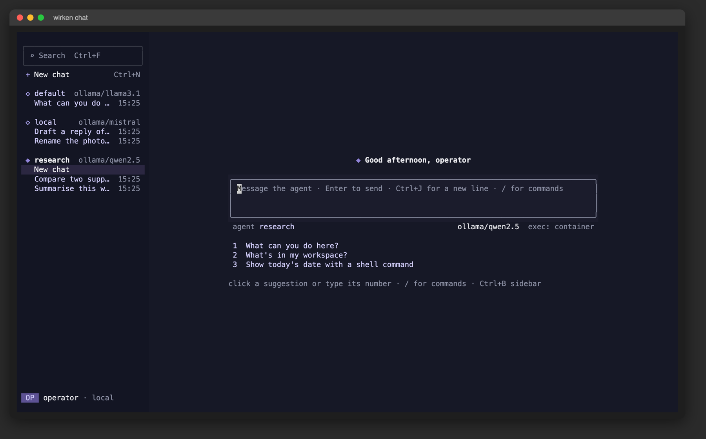

# CLI reference

Command surface only. Mechanisms live on their owning pages and are linked
rather than restated.

## wirken setup

Interactive wizard: provider, channels, credentials, service, sandbox, audit.

| Option | Description |
|--------|-------------|
| `--install-service` | Install as a systemd (Linux) or launchd (macOS) service |
| `--uninstall-service` | Remove the system service |
| `--org <URL>` | Pull provider, SIEM, MCP and permission config from a company endpoint. See [enterprise.md](enterprise.md) |

## wirken run

Starts the gateway. Spawns adapter processes, serves WebChat, accepts
connections.

| Option | Description |
|--------|-------------|
| `-p, --port <PORT>` | WebChat port (default: 18790) |

### What WebChat serves

Every route is bound to loopback and checks the `Host` header against the
loopback names for the bound port, which is what closes DNS rebinding. The
state-changing routes (`POST /api/chat`, `POST /api/approvals/{id}`,
`POST /api/verify`) also require a matching `Origin`; safe reads validate
one only when the browser sends it, because a browser omits it on a
same-origin GET.

Routes match on the request path with the query string taken off. They
used to match the request line up to the space after the path, so a
target carrying a query reached no route: `GET /api/approvals?c=<key>` is
the only request the page makes to that route, and it answered 404. With
it refused the page's approvals snapshot stayed null, which meant no
"awaiting you elsewhere" chip, no other-channel badge, no awaiting marker
in the rail, and no pending card restored after a reload however many
decisions were waiting.

The approval card shows the action key, the arguments the model sent,
what the model said in the same message and, for an `exec`, where it runs
if approved, all off the `ApprovalRequest` event. See
[permissions](permissions-and-identity.md#what-an-approval-prompt-shows).

The About panel draws the capabilities of the conversation it is open on.
It asked `/api/capabilities` with no conversation key, so it always
showed the legacy conversation: a turn running in the conversation
being viewed read as idle, and a turn in the legacy one read as busy. It
sends the key now and reloads when a switch happens while it is open.

## wirken chat

A full-screen chat in this terminal. `wirken` with no subcommand runs it.

```bash
wirken                                   # chat with the default agent
wirken chat [--agent <AGENT>] [MESSAGE]  # a configured agent; MESSAGE is sent first
```

`--persona` is an interchangeable alias for `--agent`, as for `ask`. When
nothing is configured at all (no `provider.json` and no agent rows), the
chat runs the setup wizard before it opens; an `--agent` that names no
configured agent is an error. It refuses to start when stdin or stdout is
not a terminal; a script uses `wirken ask`.

### Agents and what they run under

Each agent is resolved as `wirken ask` resolves it (`resolve_agent` in
`crates/cli/src/commands/agent.rs`): the configured agent row or the legacy
`provider.json`, the API key from its vault slot, the operator's sandbox
config and the agent's skills. The chat resolves every configured agent
before the screen comes up, so a vault passphrase prompt reaches a plain
terminal, and wakes them through one `AgentFactory`, as `wirken run` does.
The factory carries the gateway's permission store, the leak matcher seeded
from every stored secret, the chat's approval card as the gate, the org tool
policy from `tool_policy.json`, and budget enforcement from `budget.json`,
failing closed as `wirken run` does: a malformed `budget.json`, or a
block-mode budget whose `budget.db` cannot be opened, stops the chat. What
needs the daemon is not attached: hook processes (the Safety card names any
registered hooks, which do not see the chat's calls), MCP servers, the
memory and imported-archive stores, and the vault resolver an
`http_request` naming a credential goes through, so such a call refuses.
An agent that cannot be resolved is listed as unavailable; a click on it
gives the reason and leaves the conversation as it is. Agents added after
the chat started appear when it is started again.

The model is operator configuration and there is no command to switch it;
see [enforcement-model.md](enforcement-model.md#model-governance). Two chats
on two models are two agents, for example one on `openai` and one on
`ollama`, added with `wirken agents add`; two terminals can run
`wirken chat --agent` on each at the same time.

Each conversation is its own audit lane, `{agent}/chat/c-<id>`, so
`wirken sessions verify` takes the id. The chat seals a lane with a
`SessionEnd` head when it leaves it: a new conversation, `/clear`, opening
another conversation or agent, `/setup`, `/quit`, Ctrl+C or Ctrl+D, a
SIGTERM, SIGHUP or SIGINT, and a panic. A lane is sealed only when it holds
rows the last head does not cover; a conversation opened only to read it is
not written to. The chat opens no socket.

### Approvals


A Tier 2 or Tier 3 action shows an approval card in the transcript. Its
header says in words what the agent wants to do ("wants to run a
command"), a badge says what a yes covers ("asks until granted" for Tier 2:
a yes approves this call only, and `wirken permissions approve` stores a
grant; "asks every time" for Tier 3), a band shows the command, path or
address, and below come the lines the `ask` prompt shows: the action key,
the arguments the model sent, where an `exec` runs, what the model said,
and the message it is in reply to
(`chat::gate::tests::the_card_carries_the_cli_prompt_lines` pins this).

`y` or `yes` alone, then Enter, or the Approve button approves. `n` or `no`,
with any words after it as the reason the model is told, an empty line,
Esc or the Deny button denies. Any other line is not an answer and stays in
the composer, so `yes and also check the logs` approves nothing. A draft
being typed when a card arrives is set aside and given back once every card
is answered. For the first 0.7 seconds a card is on screen, an approval by
key or click is not taken, so a double click or a typed-ahead Enter cannot
approve a card nobody has read. Cards wait in order: `y` and `n` answer the
oldest, and a later one says it waits its turn.
`WIRKEN_ASK_APPROVAL_TIMEOUT_S` (default 60) is the deadline after which a
card expires and the chain records a `PermissionDenied` row with
`approval timeout` as its reason. An approval row carries `approved_via:
stdin` and the OS user as `approved_by`; a denial row carries `denied_via`
and the reason.

### The transcript

Tool calls and their results appear as the runtime writes them to the
chain. Each is one row with the tool, its command or path, and whether it
ran and how much it returned; a click opens its arguments and up to 40
lines of output, each cut to the width (the chain has all of it), and
Ctrl+O opens them all. Text the model writes before a call stays above the
call's row. A turn runs to completion; a message typed during one is
queued and sent when it ends, and `/clear`, a new conversation, `/setup`,
switching conversations or agents, and opening a run wait for it.

Each reply ends with when it finished, how long it took, the tokens it
used, and a copy button; the copy goes to the terminal's clipboard by
OSC 52, as Ctrl+Y does for the last reply. Text from the model, a tool or
the chain is shown, copied and exported without escape sequences and
without the invisible characters that reorder text (bidirectional
overrides, zero-width spaces). A failed turn says what went wrong in
words, with the raw error under it and a Retry button (Ctrl+R) that sends
the message again; there is no retry for a failure another try cannot
change, such as an unknown skill. Wide characters (CJK, emoji) are laid
out by their display width.

When the terminal reports focus and is not focused, a card raises a
desktop notification by OSC 9, and so does a turn longer than ten seconds
when it ends ("replied" or "failed"); in focus, a card rings the bell. A
terminal that does not report focus is treated as focused. Scrolled up, a
pill at the foot of the transcript leads back to the latest output, and
says so when new output arrived below.

| Command | Description |
|---------|-------------|
| `/help` | Commands, keys, and the skills attached to the agent |
| `/status` | Build, data dir, agent, provider/model, sandbox mode, budget, audit state, skills, stored grants, session id |
| `/skills` | The agent's skills, with availability and whether each is slash-only or auto-invocable |
| `/agents` | The agents this chat knows, with the provider/model each runs, and any unavailable with why |
| `/permissions` | Stored and session-scoped grants for this agent, as `wirken permissions list` |
| `/sessions` | This conversation, then the gateway's active sessions |
| `/context` | How full the model's context is: the last request's size against the model's window, and how Wirken trims past 80 % |
| `/cost` | Model calls, input and output tokens and spend on this conversation, from the `LlmResponse` rows; a model with no price is reported uncosted |
| `/verify` | Checks this conversation's hash chain and signed heads now, as `wirken sessions verify` does |
| `/tools` | The agent's tools grouped by whether they run freely, depend on the command, ask until a grant is stored, or ask every time |
| `/safety` | What weakens a guarantee here, each with how to undo it |
| `/runs` | The runs this conversation delegated, with state, task, ceiling and lane |
| `/export` | Saves this conversation as Markdown under `exports/` in the data directory, `chat-c-<id>-<time>.md`, readable by the operator only; the file is always new, never written over another or through a link |
| `/setup` | Leaves the screen, runs the setup wizard, re-reads the agents and returns on a new conversation; the conversation is sealed first, and Ctrl+C in the wizard leaves Wirken as it does for `wirken setup` |
| `/clear` | Seals the conversation and starts a new one |
| `/quit`, `/exit` | Seals the conversation and leaves; during a turn, a second `/quit` stops the turn and leaves |
| `/<skill> …` | Any other `/word` goes to the agent, which rewrites a known skill; an unknown one is named as unknown |

| Key | Description |
|-----|-------------|
| Enter | Send; with a card waiting, answer it; on a partial `/command`, complete it |
| Ctrl+J | Newline in the draft |
| Tab | Complete a `/command` |
| Up / Down | Messages sent in this window; with the `/` menu open, choose in it |
| 1, 2, 3, then Enter | On an empty conversation, send that suggestion |
| PgUp / PgDn, Home / End | Scroll the transcript; End follows new output again |
| Ctrl+O | Full tool arguments and output, log lines, and long code lines wrapped instead of cut |
| Ctrl+R | Send the last message again after a failed turn |
| Ctrl+Y | Copy the last reply |
| Ctrl+N | New conversation |
| Ctrl+F | Search conversation titles; Enter opens the first match. Needs the sidebar, so 100 columns |
| Ctrl+Up / Ctrl+Down, Alt+Up / Alt+Down | Previous or next conversation |
| Ctrl+B | Hide or show the sidebar |
| Ctrl+A / Ctrl+E, Ctrl+U, Ctrl+W | Start or end of the line, clear the draft, delete the word before the cursor |
| Ctrl+L | Redraw |
| Esc | Deny a card; pressed twice, clear the draft; in a run, go up a level |
| Ctrl+C | Clear the draft; with an empty draft and no turn running, leave |
| Ctrl+D | With an empty draft, leave; during a turn, as the first `/quit` |
| ? | On an empty draft with no card waiting, the same as `/help` |

### The sidebar and the panel



The sidebar lists every agent the chat knows under a header with the
provider and model it runs, and that agent's conversations under it,
newest first, titled by their first message and dated by the time today,
the weekday within the week, or the date. A click on a conversation opens
it, whichever agent it belongs to; a click on a header starts a new
conversation with that agent. When rows run short, every agent keeps its
header and newest chat, the agent on screen gets the rest, and a cut list
ends with "and N more". Search matches titles across all agents, and
Ctrl+Up / Ctrl+Down step through the list in this order. Opening a
conversation wakes its agent through the factory, which replays the lane
through the runtime's own replay path and gates it by the permission store
like every live agent, and draws the transcript from the chain. An empty
conversation shows a greeting, a centred composer and up to three
suggestions drawn from the agent's tools and skills.

Once a conversation has messages, the panel shows a column of cards, and a
click on one opens what is behind it:

| Card | Shows | A click, or the command |
|------|-------|-------------------------|
| Delegations | first, once the conversation has delegated: runs queued, running, done and failed, and which one needs you | `/runs` |
| Environment | data dir, agent, sandbox mode from `sandbox.json` (`container`, `gvisor` or `host`) | `/status` |
| Safety | only when something weakens a guarantee: an escape-hatch variable set, unacknowledged audit alarms, exec on the host, an unsigned chain, hooks the chat cannot run | `/safety` |
| Context | the last turn request's size against the model's context window, at four bytes a token | `/context` |
| Cost and tokens | calls, tokens and spend on this conversation, delegated runs included; the budget left in the window | `/cost` |
| Audit | signed or not, rows on this lane, the last check's verdict | `/verify` |
| Approvals | approvals and denials on this conversation, delegated runs included; stored grants and the soonest expiry | the decisions, then `/permissions` |
| Tools | how many tools ask you first, and which | `/tools` |

The Safety card reads the same escape hatches WebChat's status lists
(`wirken_gateway::org::parse_boolean_escape`) and the boot check's
`AlarmLog::unacknowledged_blocks`; the Tools card uses WebChat's tool tier
table. The panel is left out under 140 columns and the sidebar under 100,
and the line under the composer then carries the budget and audit state.
Mouse capture is on for clicks and the wheel; Option or Shift with the drag
gives the terminal's own selection.

### Delegated runs

An agent that `wirken agents allow-subagent` lets reach another can
delegate to it with `spawn_subagent`. Each run is a child agent on a lane of
its own, `{parent}#sub-N`, under the ceiling that command set (tools,
highest tier, rounds, runtime). The chat's runs go one after another, since
its streaming turn runs tool calls in order; a child that delegates in turn
can run its own runs in parallel, and their cards wait in order. The
transcript shows each run as a row with the child agent, its task and how
it stands: queued, running, `! needs you` while a card from it or from a
run under it waits, done, failed with why (timed out, ran out of rounds),
or no result; a click opens its ceiling, lane and answer. A child's Tier 2
or Tier 3 call raises the same card, titled with the child and the agent it
works for, at any depth, and carrying the ceiling; a card whose run ends
first (its runtime ran out) is marked withdrawn. The sidebar nests each
chat's runs under it, runs of runs under those, with the same marks, and a
chat with a run waiting shows `!`. A click on a run opens it read-only,
drawn from its own lane, once no turn is running; Esc goes up a level. When
a turn ends, the chat seals the lanes of the runs that ended in it and of
the runs under them; on the way out it seals every run's lane. The
approvals, denials and model calls of runs at any depth are counted into
the conversation's own as each run's result is read.

Log lines the gateway libraries write while the chat holds the screen are
held instead of printed over it: the footer counts them, Ctrl+O shows them
in the transcript, each distinct message once, and any not yet shown are
printed on stderr after the terminal is restored.

## wirken ask

Send a message to an agent and print the response. No channel setup needed.

```bash
wirken ask -m "your message" [--agent <AGENT>]
```

`--persona` is an interchangeable alias for `--agent`; every persona is an
`AgentConfig` row keyed by its name. Default: `default`.

When stdin is a terminal, an approval gate prompts for Tier 3 actions and
reads one line: `y` or `yes` approves, anything else denies, and text after a
space is recorded as the denial reason. The prompt says what is being
approved before it asks; see
[permissions](permissions-and-identity.md#what-an-approval-prompt-shows)
for what is on those lines and why. A piped or redirected `wirken ask`
gets no gate and short-circuits with a terminal deny, so a script does not
hang on a prompt nobody will answer. `WIRKEN_ASK_APPROVAL_TIMEOUT_S` sets the
read deadline (default 60). A prompt left unanswered past the deadline is a
denial: the model is told the action was refused and not executed, and the
chain records a `PermissionDenied` row with `approval timeout` as its reason.

## wirken channel

```bash
wirken channel add <CHANNEL>     # telegram, discord, slack, teams, matrix,
                                 # signal, google-chat, imessage, whatsapp
wirken channel list
wirken channel remove <CHANNEL>
```

Per-channel prompts, vault entries and limits: [channels.md](channels.md).

## wirken agents

```bash
wirken agents add                        # wizard, or --id/--provider/--model for scripted use
wirken agents list
wirken agents remove <ID>
wirken agents bind <AGENT> <CHANNEL>
wirken agents set <ID> [--model M] [--base-url U] [--tools-enabled true|false|auto] [--api-key]
wirken agents set-egress <ID> --channel C --mode none|allowlist|open [--domains "a,b"]
wirken agents allow-subagent <PARENT> <CHILD> [--tools T] [--max-tier tier1|tier2|tier3]
                                              [--max-rounds N] [--max-runtime S]
wirken agents deny-subagent <PARENT> <CHILD>
```

`--api-key` prompts for the value rather than taking it on the command line,
so it does not reach shell history or the process table. Defaults for
`allow-subagent`: no tools, `tier1`, 5 rounds, 30s. See
[multi-agent.md](multi-agent.md) and [egress.md](egress.md#sandbox-egress).

## wirken persona

Operator-facing bundle of an agent config plus an optional preset. See
[multi-agent.md](multi-agent.md#personas).

```bash
wirken persona create <NAME> [--preset P] [--provider P] [--model M] [--base-url U]
                             [--credential C] [--channel C]... [--allow-subagent A]...
wirken persona list
wirken persona show <NAME>
wirken persona edit <NAME> (--preset P | --clear-preset) [--provider P] [--model M]
                           [--base-url U] [--credential C] [--channel C]... [--display-name D]
wirken persona delete <NAME>
```

`edit` requires at least one field flag. `--preset` and `--clear-preset` are
mutually exclusive. `delete` leaves the workspace and per-agent skill
directories on disk.

## wirken preset

```bash
wirken preset list
wirken preset install <NAME>
wirken preset schedule <NAME>      # daily cron entry for the preset's orchestrator
wirken preset unschedule <NAME>
```

Schedule and unschedule are Linux and macOS only.

## wirken skills

```bash
wirken skills search <QUERY>
wirken skills install <NAME>
wirken skills list
wirken skills sign <DIR> [--root-key <OFFLINE_ROOT_SEED>]
wirken skills sign-index <INDEX> --root-key <OFFLINE_ROOT_SEED> --skills-dir <CHECKOUT> [--url-prefix <URL>]
wirken skills verify <DIR> [--strict]
wirken skills trust-root <PUBKEY_HEX> [--yes]
wirken skills restore-bundled
wirken skills migrate [PATH] [--dry-run]
```

`search` and `install` read the skill index at
`https://raw.githubusercontent.com/gebruder/wirken-skills/main/index.json`, or
`WIRKEN_SKILLS_INDEX` when set. No public index is published yet: that URL
returns 404, and both commands stop with an error naming it.
`list` prints a row for every installed skill. One that loaded shows how its
signature passed: `self-signed`, `delegated`, or `no` under the unsigned
opt-in. One that did not load shows `refused:` and the reason, and a bundled
copy that `restore-bundled` would fix says so.
`--strict` on `verify` treats a self-signed bundle as a failure and exits 1.
`trust-root` installs an operator root so the loader requires delegation. It
first lists the installed skills that would stop loading under that root and
asks for confirmation; `--yes` skips the question. `restore-bundled` gives
each installed bundled skill whose `SKILL.md` is unmodified the signature files
shipped with it, which is what makes those copies load under the project root.
It installs nothing else and leaves the root alone.
`migrate` rewrites deprecated `metadata.openclaw.*` keys, backing each file up
first. See [signing.md](signing.md#skill-signing) and [skills.md](skills.md).

## wirken mcp

```bash
wirken mcp authorize <SERVER> [--scope ID]... | [--no-scopes] | [--all-scopes]
wirken mcp sign <SERVER>
wirken mcp verify [<SERVER>]
```

See [mcp.md](mcp.md) and [credentials.md](credentials.md).

## wirken hooks

```bash
wirken hooks register <ID> <PUBKEY_HEX> --type <observe|veto|egress>
```

See [enforcement-model.md](enforcement-model.md#veto-and-egress-hooks) and
[siem-forwarder.md](siem-forwarder.md#observe-hook).

## wirken approvers

Channel-adapter approver allowlist and per-adapter approval chat.

```bash
wirken approvers add <ADAPTER_ID> <USER_ID> [--display NAME]
wirken approvers list [--adapter A]
wirken approvers remove <ADAPTER_ID> <USER_ID>
```

## wirken cron

```bash
wirken cron create <SCHEDULE> <MESSAGE> [--agent A] [--description T]
wirken cron list [--agent A]
wirken cron delete|pause|resume <JOB-ID>
```

Standard 6-field cron: `sec min hour day month weekday`. `0 0 9 * * *` is
daily at 09:00, `0 */30 * * * *` every 30 minutes, `0 0 0 * * Mon` Mondays at
midnight.

## wirken audit

```bash
wirken audit log [OPTIONS]
wirken audit verify [--require-signed] [--anchor HEX_OR_PATH]... [--format human|json]
wirken audit verify-attestations [--agent AGENT]
wirken audit acknowledge --all
```

Flags, exit codes, JSON schema and what each verification proves:
[audit-cli.md](audit-cli.md).

## wirken sessions

```bash
wirken sessions list [--channel C] [--parent SESSION_ID]
wirken sessions close <SESSION-ID>
wirken sessions verify <SESSION-ID> [--strict] [--with-parent]
```

What `verify` replays and what a `tools_hash` attests:
[audit-cli.md](audit-cli.md#wirken-sessions-verify).

## wirken permissions

```bash
wirken permissions list [--agent A]
wirken permissions approve <KEY> [--agent A] [--session ID] [--expires-in-days N]
wirken permissions revoke <KEY> [--agent A]
wirken permissions list-pending [--agent A]
wirken permissions pending list
wirken permissions pending show <REQUEST_ID>
wirken permissions pending approve <REQUEST_ID>
wirken permissions pending deny <REQUEST_ID> [REASON]
```

`list-pending` walks the audit log for historical denials with no matching
approval. The `pending` subgroup operates on the gateway's in-memory queue of
in-flight requests and resumes the awaiting agent task; ids accept any prefix
unique to one row. Which keys are storable, and the grant window:
[permissions-and-identity.md](permissions-and-identity.md).

## wirken credentials

```bash
wirken credentials list
wirken credentials add <NAME> [--channel C] [--stdin | --value-file FILE] [--host HOST]...
wirken credentials rotate <NAME> [--stdin | --value-file FILE]
wirken credentials show <NAME>
wirken credentials remove <NAME>
wirken credentials rescope <NAME> [--scope ID]... | [--no-scopes] | [--all-scopes]
```

Every verb takes the vault passphrase from `WIRKEN_VAULT_PASSPHRASE` when set
and prompts only when it is not, so `add` and `rotate` complete with no
terminal. `--host` binds a credential to hosts `http_request` may send it to;
see [egress.md](egress.md#credential-host-binding). Scopes and redaction:
[credentials.md](credentials.md).

## wirken vault

```bash
wirken vault reset
```

Destroys the device key and all stored credentials. Used after a forgotten
passphrase, where the vault refuses to overwrite a keychain it cannot unwrap.
Requires typing `reset`.

## wirken zirkel

```bash
wirken zirkel run
wirken zirkel bind --channel C --conversation ID [--agent A] [--force]
wirken zirkel unbind [--agent A]
wirken zirkel status
wirken zirkel auth-set --source SOURCE
wirken zirkel auth-list
wirken zirkel calibrate [--run-id R] [--buckets N] [--by overall|source|keyword]
```

See [zirkel.md](zirkel.md).

## wirken lyrik

```bash
wirken lyrik run --target DIR --run RUN_ID [--use-fixture FINDINGS_JSON]
wirken lyrik report [--format sarif] (--findings PATH | --run RUN_ID) --output PATH
wirken lyrik validate --path PATH
```

See [lyrik.md](lyrik.md).

## wirken import

```bash
wirken import <ARCHIVE> [--sealed]
```

`--sealed` declares the source account closed; a sealed source imports once
and refuses afterwards, and there is no unseal. See
[imported-archives.md](imported-archives.md).

## wirken update

```bash
wirken update --check
wirken update [--to <VERSION>] [--allow-downgrade] [--base-url <URL>]
wirken update --rollback
```

Checks for, installs, or rolls back a signed release. Runs only when asked.
Install and rollback need a terminal and a stopped gateway, and ask for a
typed confirmation. `--base-url` must be on a loopback address or be the
mirror in `<data_dir>/update.json`. See [update.md](update.md).

## wirken status

```bash
wirken status
```

Prints the version, commit, dirty flag, build age from the commit's
timestamp, target and binary path. Makes no network request.

## wirken doctor

```bash
wirken doctor
```

Checks the data directory, provider config, vault access, adapter registry,
MCP signing, the audit log and its alarm log, the attestation chain across all
sessions, Docker, and gVisor.
