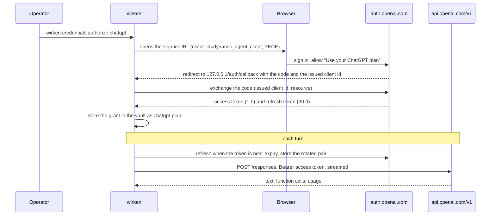

# Credentials and OAuth scopes

Wirken's credential vault is XChaCha20-Poly1305-encrypted under a device
key. The default build wraps the device key with a passphrase (Argon2id) in
`<data_dir>/keychain/`; builds with the `keychain-macos` or `keychain-linux`
feature keep it in the OS keychain. Two kinds of credentials live in it:

- **Raw secrets**: API keys, channel tokens, MCP server bearer
  tokens. Operators add these with `wirken credentials add`.
- **OAuth-managed credentials**: bootstrapped via `wirken mcp
  authorize <server>` against a known OAuth provider. The vault
  stores the access token, refresh token, and the granted scope
  set; the gateway refreshes the access token when it nears expiry,
  on the MCP proxy's request, and writes the vault.

Each entry is a **secret** or an **identifier**. Leak detection refuses
model-authored content, and content on its way to the model, that carries a
stored secret ([architecture.md](architecture.md#2-credential-lifecycle)); an
identifier (a phone number, a URL, a username, a project number) may appear
in messages and is not matched. An entry is a secret unless it is marked an
identifier: the nine built-in adapter identifiers (`teams-app-id`,
`matrix-homeserver`, `matrix-username`, `whatsapp-phone-number-id`,
`signal-endpoint`, `signal-phone-number`, `signal-allowed-senders`,
`google-chat-project-number`, `imessage-bluebubbles-url`) are marked when
stored, and an operator marks others with `wirken credentials add NAME
--identifier`. `wirken credentials list` and `show` print the kind. A secret
under 8 bytes is not matched, and the gateway names it in a warning at start.

## Which processes read the vault

- **The gateway** (`wirken run`) opens the vault. It resolves provider
  keys and `http_request` credentials, and reads each adapter's
  credentials when it spawns or respawns the adapter.
- **Adapters** never open the vault. Each starts with its own
  channel's credentials, which the gateway writes to its stdin, and
  gets no vault passphrase.
- **The MCP proxy** never opens the vault. At spawn the gateway
  writes to its stdin the names its `mcp.json` configs reference: the
  `vault:` env values of stdio servers and the `credential` of HTTP
  servers' bearer and OAuth auth, each OAuth credential without its
  refresh token. When an access token nears expiry the proxy asks the
  gateway, over a 0600 Unix socket that serves only the proxy's own
  process holding a token handed to it at spawn (on Windows, the token
  alone), to refresh it; the
  gateway refreshes only credentials it handed the proxy, calls the
  provider, writes the vault, and answers with the access token. The
  proxy gets no vault passphrase and never holds the device key or a
  refresh token. When an HTTP server refuses a credential (a 401, or
  `error="invalid_token"`), the proxy asks the gateway, on the same
  socket and under the same checks, for its current value, and the next
  call carries it: a credential rotated in the vault reaches an HTTP
  server without a restart. Each value sent is an
  `mcp_credential_refetched` row naming the credential. A stdio server's
  `vault:` values are fixed when it starts and change at the next
  gateway start.
- **`wirken` commands** that manage credentials (`credentials`,
  `channel add`, `setup`, `mcp authorize`) open the full vault in the
  operator's own process.

This page covers OAuth-managed credentials specifically: the
interactive scope picker, the non-interactive flags, and the
commands that inspect and re-grant existing OAuth credentials. For
raw-secret lifecycle (`add`, `rotate`, `remove`) see `wirken
credentials --help`.

## OAuth scope picker

When you authorize an OAuth-backed MCP server, wirken shows an
interactive picker listing the scopes the provider's catalog
supports. Required scopes are auto-included; the picker only
presents optional scopes for you to toggle.

```bash
wirken mcp authorize linear
wirken mcp authorize github
wirken mcp authorize google
```

Notion does not use OAuth scopes (Notion grants permissions per
workspace through its own connection UI), so wirken short-circuits
the picker for that provider and proceeds with no optional scopes.

After you submit the picker, wirken prints a confirmation section
listing every scope about to be requested (provider defaults,
required scopes, and your selected optional scopes) so you can
verify before the browser opens.

## Non-interactive scope selection

For scripted or CI use, three flags skip the picker:

```bash
wirken mcp authorize github --scope repo --scope read:org
```

Explicit scope selection. Repeat `--scope` for each id. Required
scopes are still auto-included. Unknown scope ids error with the
catalog listed.

```bash
wirken mcp authorize github --no-scopes
```

Minimum grant: required scopes only.

```bash
wirken mcp authorize github --all-scopes
```

Maximum grant: every scope in the provider's catalog.

If stdin is not a TTY and none of these flags are passed, wirken
exits with an error asking for an explicit scope selection.

The three flags are mutually exclusive at the clap layer; passing
more than one is a parse error.

## Inspecting and changing scopes

```bash
wirken credentials list
```

Shows credential name, channel, creation time, status, and a
SCOPES column. OAuth credentials display a scope count (for
example `5 scopes`); raw secrets display `n/a`. The footer points
operators at `wirken credentials show <name>` for detail.

```bash
wirken credentials show <name>
```

Pretty-prints one credential's non-secret metadata: channel,
timestamps, plus provider and the granted scope list for OAuth
credentials. The secret itself is never displayed; the function
routes OAuth credentials through a non-secret view that does not
carry the bearer tokens.

```bash
wirken credentials rescope <name>
```

Re-runs the OAuth authorization flow for an existing credential
with a new scope selection. The picker is pre-seeded with the
credential's currently-granted optional scopes so you can add or
drop without retyping the whole set. The same `--scope`,
`--no-scopes`, and `--all-scopes` flags are available for
scripted rescoping.

On success the vault row is replaced atomically. On cancel or
authorization failure the existing credential is left unchanged:
the function returns before any vault mutation.

Non-OAuth credentials cannot be rescoped; the command errors with
a typed message before any picker UI is rendered. Use `wirken
credentials rotate <name>` to replace a raw secret.

Every credentials verb reads the vault passphrase from
`WIRKEN_VAULT_PASSPHRASE` when it is set and prompts only when it is
not. `add` and `rotate` take the value from `--stdin` or
`--value-file`, so a setup script or a container entrypoint can store
or replace a credential with no terminal.

## Scope-not-granted failures

If a tool call fails because the OAuth credential is missing a
scope the tool needs, wirken detects the failure at the MCP
transport layer and surfaces a typed error to the agent. The
tool result reads:

```
Tool call refused: credential '<name>' missing scope <hint>.
Run: wirken credentials rescope <name>
```

When the provider's response named the specific scope, `<hint>`
carries the scope id. When the response indicated insufficient
scope generically, the message reads:

```
Tool call refused: credential '<name>' may be missing required
scope. Run: wirken credentials rescope <name> to review.
```

Detection is per-provider: GitHub REST 403 responses (e.g.
"Resource not accessible by integration"), Linear GraphQL
`FORBIDDEN` / `AUTHENTICATION_ERROR` extensions combined with
insufficient-permissions wording, and Google REST envelopes
carrying `insufficientPermissions` or "Request had insufficient
authentication scopes." Notion does not use OAuth scopes and is
not detected; its auth failures surface as generic tool errors.

Detectors are conservative. An auth error wirken cannot
classify with confidence falls through to the generic
tool-error path, where the operator sees the provider's raw
response. In that case the manual workflow still applies:

```bash
wirken credentials show <name>
wirken credentials rescope <name>
```

The detection logic is source-derived: each parser is built
against the provider's documented error format. The first
real-world failure that hits a detector either confirms the
shape or surfaces a refinement.

## Type-enforced secret redaction

Two layers protect against accidental token disclosure:

1. `wirken credentials show` and `wirken credentials list` route
   OAuth credentials through a non-secret view type that carries
   only `{ provider, scopes, expires_at }`. The bearer tokens live
   exclusively inside the MCP-proxy crate; the display paths
   cannot read them, regardless of what a future contributor adds
   to the code.

2. The underlying `OAuthCredential` type (used by the OAuth flow
   internally) has a hand-written `Debug` impl that replaces
   `access_token` and `refresh_token` with `<redacted>` in any
   `{:?}`, `tracing!`, or `dbg!` output. There is no `Display`
   impl, so `{}` print is a compile error.

Together these mean a bearer token cannot reach stdout, stderr,
or the tracing log through ordinary Rust formatting. The encrypted
vault row remains the only place the secret exists outside of an
in-flight HTTP request.

## ChatGPT plan (Sign in with ChatGPT)

The `chatgpt` provider runs agents on the operator's ChatGPT plan (Go, Plus
or Pro) instead of an API key, under OpenAI's program for open-source and
locally run apps
([developers.openai.com/siwc/token-sharing-open-source](https://developers.openai.com/siwc/token-sharing-open-source)).
Wirken is a public OAuth client with no secret: the first sign-in registers
it (`client_id=dynamic_agent_client`), the callback carries the issued id,
and that id is stored with the grant and used for every later request.

```bash
wirken setup                                   # pick "ChatGPT plan"
wirken credentials authorize chatgpt           # or sign in on its own
wirken agents add --provider chatgpt --model <slug> --credential chatgpt-plan
```

The sign-in once, then every turn:



**What is stored.** One OAuth-managed entry, `chatgpt-plan` by default:
access token, rotating refresh token, expiry, granted scopes and the issued
client id, encrypted like every other entry. `wirken credentials show
chatgpt-plan` prints provider, scopes and expiry and never a token. A grant
that lacks `chatgpt.tokens.use.direct`, the scope that permits plan usage, is
not stored: the operator declined the one thing the credential is for, and
the command says so. `<data_dir>/chatgpt-host-id` holds the host identifier
the provider attributes usage to; it is an opaque label, not a credential.

**Refresh.** The access token lives an hour. The gateway (and `wirken ask`)
asks for the current token before each call and refreshes it in process
when it is within five minutes of expiry, serialised per entry because the
provider rotates the refresh token on every use; the refreshed value is
written to the vault and taught to leak detection. A refresh the provider
refuses outright (`invalid_grant`, an expired or reused refresh token) fails
the turn with a message naming `wirken credentials rescope chatgpt-plan`,
which signs in again with the saved client id. A refresh that fails for a
network reason keeps using the token until it expires.

**Inference.** The plan accepts `POST https://api.openai.com/v1/responses`
and nothing else, streaming, storing nothing, with the system prompt as
`instructions` and no `temperature` or `max_output_tokens`. Function tools
work, so the tool loop is unchanged; `generate_image` is refused on this
provider, as the plan route does not serve image generation. A usage-limit refusal
(`subscription_sharing_usage_limit_exceeded`) is never retried: the turn
fails with a `LlmRequestFailed` row and the gateway log points at
`chatgpt.com/settings/usage`, where the weekly cap for the "Wirken" app is
set. `LlmRequest` rows carry `provider: chatgpt` and `credential_id:
chatgpt-plan`; cost is uncosted ([cost-monitoring.md](cost-monitoring.md)).

**Removal.** `wirken credentials remove chatgpt-plan` revokes the grant at
the provider before deleting the entry, best effort; if revocation could not
be confirmed, disconnect the app under ChatGPT Settings, Security and login,
Login connections.

**Headless hosts.** The sign-in needs a browser that can reach the loopback
callback. On a server, run `wirken credentials authorize chatgpt --port 1455
--no-browser` and open the printed URL from a machine with `ssh -L
1455:127.0.0.1:1455 <host>` in place, which carries the redirect back. OpenAI
also documents signing in on a laptop and copying the credential file to the
server over SSH; the vault entry is that file here, so `wirken credentials
add chatgpt-plan --channel oauth --value-file <json>` with the grant's JSON
does the same (the `oauth` tag is what `show` and `rescope` go by).

**Limits to know.** The grant is the operator's own plan; it is meant for a
personal gateway, bound to one agent, and the per-app weekly cap is the
exposure limit. A `channel_overrides` entry cannot name `chatgpt`: an
override carries a static key, and the plan grant is refreshed per call. The
identity scopes the sign-in requests are not read; nothing about the account
beyond the tokens is kept.
